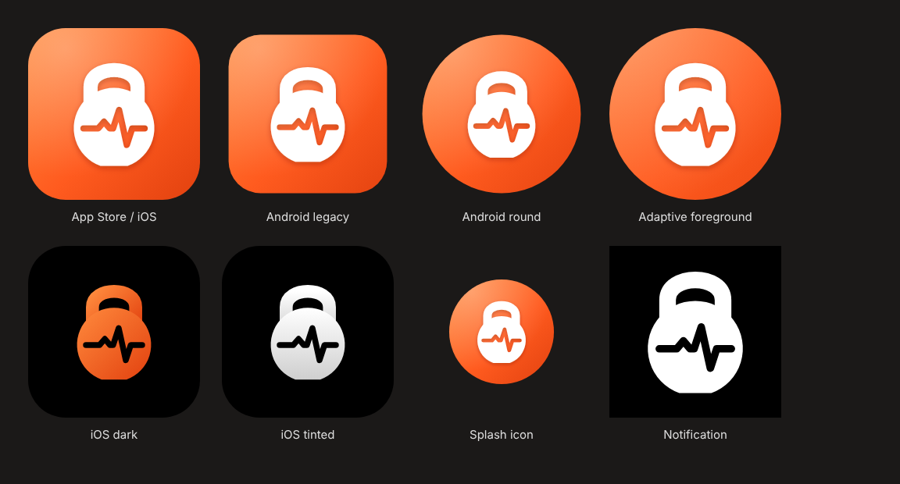

# FitCue — app icons, launcher & launch screens

Everything is generated from the master artwork in [`generate.py`](generate.py) (SVG sources in `source/`). Change a colour or the mark there and run `python3 generate.py` to rebuild every size.

**Mark:** a kettlebell (fitness) with a heartbeat line cut through it (health), in white on the ember gradient `#FF8A3D → #FF5B1F → #E2410F`. The launch and splash background is the app background `#0D0B0A`.

---

## iOS (`ios/`)

| Path | What it is | Where it goes |
|---|---|---|
| `Assets.xcassets/AppIcon.appiconset/` | Single 1024 px icon + **iOS 18 dark** and **tinted** versions (Xcode 14+ generates every smaller size) | Replace `AppIcon.appiconset` in your app's `Assets.xcassets` |
| `legacy-sizes/AppIcon.appiconset/` | Every size listed separately (iPhone 40–180 px, iPad 20–167 px, marketing 1024) | Use instead of the folder above only if your Xcode or template needs every size |
| `Assets.xcassets/LaunchLogo.imageset/` | Logo tile for the launch screen, @1x/@2x/@3x | Copy into `Assets.xcassets` |
| `Assets.xcassets/LaunchBackground.colorset/` | Launch background colour `#0D0B0A` | Copy into `Assets.xcassets` |
| `LaunchScreen.storyboard` | Centred 112 pt logo on the background colour | Replace your `LaunchScreen.storyboard` (Target → General → Launch Screen File) |

The light 1024 icons have no alpha channel, as App Store Connect requires. The dark and tinted versions are transparent, as Apple specifies.

## Android (`android/app/src/main/res/`)

Copy the whole `res` folder over `android/app/src/main/res` (it only adds or replaces these files).

| Files | What it is |
|---|---|
| `mipmap-anydpi-v26/ic_launcher.xml`, `ic_launcher_round.xml` | **Adaptive icon** (Android 8+): background + foreground + **monochrome** layer for Android 13+ themed icons |
| `mipmap-*/ic_launcher_foreground.png`, `ic_launcher_background.png`, `ic_launcher_monochrome.png` | Adaptive layers, 108 dp at every density (mark kept inside the 66 dp safe zone) |
| `mipmap-*/ic_launcher.png`, `ic_launcher_round.png` | Legacy launcher icons for Android 7 and below (48 dp, mdpi → xxxhdpi) |
| `drawable-*/splash_icon.png` | **Android 12+ splash** icon (288 dp canvas, fits the 192 dp circle) |
| `values/splash_theme.xml` | `Theme.FitCue.Starting` splash theme (uses `androidx.core:core-splashscreen`) |
| `drawable-*/ic_stat_notification.png` | Push notification small icon (white + transparency only, 24 dp) |
| `values/ic_launcher_colors.xml` | Icon, splash and notification colours |

`android/AndroidManifest.snippet.xml` shows the manifest lines: `android:icon`, `android:roundIcon`, the splash theme, and the Firebase default notification icon and colour.

## Stores (`store/`)

| File | Size | Use |
|---|---|---|
| `app-store-icon-1024.png` | 1024 × 1024, no alpha | App Store Connect (also inside the iOS icon set) |
| `play-store-icon-512.png` | 512 × 512 | Google Play Console → Store listing → App icon |
| `play-feature-graphic-1024x500.png` | 1024 × 500 | Google Play Console → Feature graphic (required) |

## Expo / React Native (`expo/`)

Copy the PNGs into your project's `assets/` folder and merge `app.json.snippet` into `app.json`. It covers the icon, Android adaptive + monochrome icon, splash (`expo-splash-screen`), notification icon (`expo-notifications`) and web favicon. For bare React Native, use the `ios/` and `android/` folders instead.

## Still to make (needs real app content)

- **App Store screenshots** (6.9" iPhone 1320 × 2868 is enough; iPad if you ship for iPad) and **Play phone screenshots** (min 2). The mockups in `mockups/png/` are a good base.
- **Optional:** an animated splash (Android 12 supports an animated vector up to 1000 ms).
